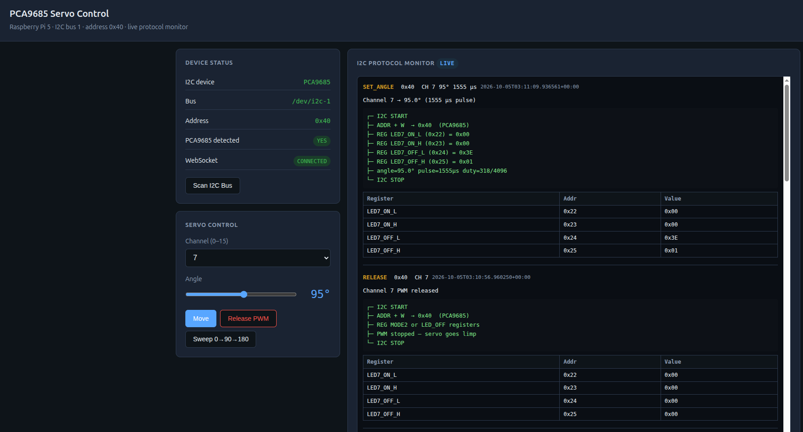

# PCA9685 Micro Servo Control on Raspberry Pi 5

Control micro servos (e.g. SG90, MG90S) on a **Raspberry Pi 5** using a **PCA9685** 16-channel I2C PWM driver board.

## Hardware

| Item | Notes |
|------|-------|
| Raspberry Pi 5 (8 GB) | Tested on Pi 5 with Bookworm |
| PCA9685 PWM driver board | 16 channels, I2C, default address `0x40` |
| Micro servo (SG90, etc.) | 5V, ~500 mA peak per servo |
| Separate 5V power supply | USB charger, bench supply, or 4× AA pack |
| Jumper wires | For I2C and servo signal |

## Wiring

The PCA9685 has **two separate power inputs**. Both are required for servo movement.

| Terminal | Voltage | Purpose |
|----------|---------|---------|
| **VCC** (pin header) | 3.3V from Pi | Powers the PCA9685 logic chip only |
| **V+** (screw terminal) | 5V external | Powers the servo motors |
| **GND** | Shared ground | Must connect Pi GND and 5V supply (−) together |

### Raspberry Pi 5 → PCA9685 (I2C)

| Pi 5 pin | GPIO | PCA9685 |
|----------|------|---------|
| Pin 1 — 3.3V | — | VCC |
| Pin 3 — SDA | GPIO 2 | SDA |
| Pin 5 — SCL | GPIO 3 | SCL |
| Pin 6 — GND | — | GND |

### 5V power supply → PCA9685 (servo power)

| Supply | PCA9685 |
|--------|---------|
| 5V (+) | V+ screw terminal |
| GND (−) | GND screw terminal |

**Important:** The 5V supply ground and the Pi ground must be tied together (use the same GND screw terminal on the PCA9685).

### Servo → PCA9685

| Servo wire | Color (typical) | Connect to |
|------------|-----------------|------------|
| Signal | Orange / Yellow | Any channel pin (CH0–CH15) |
| Power | Red | V+ screw terminal |
| Ground | Brown / Black | GND screw terminal |

### Wiring diagram

```
                         ┌─────────────────────────┐
  Pi Pin 1 (3.3V) ──────►│ VCC                     │
  Pi Pin 3 (SDA)  ──────►│ SDA                     │   PCA9685
  Pi Pin 5 (SCL)  ──────►│ SCL                     │
  Pi Pin 6 (GND)  ──────►│ GND ◄───────────────────┼───┐
                         │                         │   │
  [5V Supply]            │ V+ ◄── 5V (+)           │   │  shared ground
    (+) ─────────────────┤                         │   │
    (−) ─────────────────┤ GND                     │   │
                         │                         │   │
                         │ CH15 (or CH0) ──────────┼───┼──► Servo signal
                         └─────────────────────────┘   │
                                                         │
  Servo red   ───────────────────────────────────────────┘──► V+ terminal
  Servo brown ──────────────────────────────────────────────► GND terminal
```

### Power supply options

| Source | Notes |
|--------|-------|
| USB phone charger (5V, 1A+) | Easiest; cut a USB cable (red = +, black = −) |
| Bench power supply | Set to 5V, 1–2A per servo |
| 4× AA battery pack (~6V) | Works for micro servos |
| Pi Pin 2/4 (5V) | **Testing only** with one servo — can cause Pi brownouts under load |

**Do not** power multiple servos from the Pi 5V pin. Use a separate supply on the PCA9685 **V+** terminal.

## Raspberry Pi 5 setup

### 1. Enable I2C

```bash
sudo raspi-config
# Interface Options → I2C → Enable → Reboot
```

Or edit `/boot/firmware/config.txt`:

```
dtparam=i2c_arm=on
```

Then reboot:

```bash
sudo reboot
```

### 2. Verify I2C

After reboot you should see `/dev/i2c-1` (header I2C). Buses `i2c-13` and `i2c-14` are internal — ignore them.

```bash
ls /dev/i2c-*
# /dev/i2c-1  /dev/i2c-13  /dev/i2c-14

sudo i2cdetect -y 1
# PCA9685 appears at address 40
```

### 3. Add user to i2c group

```bash
sudo usermod -aG i2c $USER
# log out and back in
```

## Python environment

```bash
cd ~/servo
python3 -m venv ~/servo-env
source ~/servo-env/bin/activate
pip install adafruit-blinka adafruit-circuitpython-servokit lgpio
```

`lgpio` is required on Pi 5 — Adafruit Blinka uses it for GPIO/I2C access.

## Project files

| File | Description |
|------|-------------|
| `servo_test.py` | Main demo — ServoKit, channel 15, sweeps 0°→90°→180°, releases PWM |
| `test_servo_i2c.py` | Same pattern as above on channel 0 |
| `servo_api.py` | Reusable low-level PCA9685 module (`set_servo_angle`, `release_servo`) |
| `test.py` | Demo using `servo_api` on channel 15 |
| `servo_controller.py` | ServoKit wrapper with I2C protocol logging |
| `server.py` | FastAPI server — REST API + WebSocket + web UI |
| `static/index.html` | Web UI for servo control and live I2C monitor |
| `pca9685-servo-control-dashboard.png` | Screenshot of the PCA9685 Servo Control dashboard |
| `requirements.txt` | Python dependencies |

## API server and web UI

A FastAPI server provides REST endpoints, a web UI, and a **live I2C protocol monitor** that shows decoded PCA9685 register writes for every servo command.

### Install and start

```bash
source ~/servo-env/bin/activate
cd ~/servo
pip install -r requirements.txt
python3 server.py
```

Open in a browser:

```
http://<pi-ip>:5080
```

The page is the PCA9685 Servo Control dashboard. It shows device status, channel and angle controls, and the live I2C protocol monitor.



### REST API

| Method | Endpoint | Description |
|--------|----------|-------------|
| `GET` | `/api/status` | Device info + I2C bus scan |
| `GET` | `/api/i2c/scan` | Run `i2cdetect` on bus 1 |
| `GET` | `/api/i2c/events?limit=50` | Recent I2C protocol events |
| `POST` | `/api/servo/{channel}/angle` | Set angle `{"angle": 90}` |
| `POST` | `/api/servo/{channel}/release` | Stop PWM (servo goes limp) |
| `POST` | `/api/servo/{channel}/sweep` | Sweep `{"angles": [0,90,180], "delay_s": 1}` |

Interactive API docs: `http://<pi-ip>:5080/docs`

### WebSocket (live I2C monitor)

Connect to `ws://<pi-ip>:5080/ws/i2c` for real-time protocol events. Each event includes:

- I2C address (`0x40`)
- PCA9685 register names and hex values (`LEDn_ON_L`, `LEDn_OFF_L`, etc.)
- Pulse width (µs) and duty cycle
- ASCII protocol trace (`START → ADDR+W → REG writes → STOP`)

### Example API calls

```bash
# Set channel 15 to 90°
curl -X POST http://localhost:5080/api/servo/15/angle \
  -H "Content-Type: application/json" \
  -d '{"angle": 90}'

# Release PWM
curl -X POST http://localhost:5080/api/servo/15/release

# Sweep like servo_test.py
curl -X POST http://localhost:5080/api/servo/15/sweep \
  -H "Content-Type: application/json" \
  -d '{"angles": [0, 90, 180], "delay_s": 1}'
```

## Usage (CLI scripts)

Activate the virtual environment first:

```bash
source ~/servo-env/bin/activate
cd ~/servo
```

### ServoKit (high-level)

```bash
python3 servo_test.py
```

```python
from adafruit_servokit import ServoKit
import time

kit = ServoKit(channels=16, address=0x40)
channel = 15

kit.servo[channel].set_pulse_width_range(500, 2500)
kit.servo[channel].angle = 90
time.sleep(1)
kit.servo[channel].angle = None  # stop PWM — servo goes limp
```

### Low-level API

```bash
python3 test.py
```

```python
from servo_api import set_servo_angle, release_servo
import time

channel = 15
set_servo_angle(channel, 90)
time.sleep(1)
release_servo(channel)
```

## Servo calibration

Default pulse range is **500–2500 µs** (0°–180°). If the servo strains or buzzes at the ends, narrow the range:

```python
kit.servo[channel].set_pulse_width_range(1000, 2000)
```

Or in `servo_api.py`, adjust `PULSE_MIN_US` and `PULSE_MAX_US`.

## Why servos get hot

Setting an angle keeps the PCA9685 sending PWM pulses continuously. The motor stays energized to **hold position**, which draws current and produces heat.

**Fix:** Release the servo when you don't need holding torque:

```python
# ServoKit
kit.servo[channel].angle = None

# servo_api
release_servo(channel)
```

| Temperature | Meaning |
|-------------|---------|
| Warm after holding 30+ seconds | Normal for cheap micro servos |
| Too hot to touch | Stall, wrong pulse range, or mechanical overload |
| Constant buzzing | Likely pushed past mechanical limit — narrow pulse range |

## Troubleshooting

| Problem | Solution |
|---------|----------|
| `No module named 'lgpio'` | `pip install lgpio` |
| No `/dev/i2c-1` | Enable I2C: `dtparam=i2c_arm=on`, reboot |
| `No I2C device at address: 0x40` | Check SDA/SCL/GND/VCC wiring; confirm power to PCA9685 logic |
| `i2cdetect` shows nothing on bus 1 | Verify connections on pins 3, 5, 6, and 1 |
| Servo doesn't move | Connect separate 5V to **V+** terminal; tie grounds together |
| Pi resets when servo moves | Servo drawing too much from Pi — use external 5V supply |
| Servo jitters | Use a dedicated 5V supply with enough current; shorten wires |
| Wrong angles | Calibrate `set_pulse_width_range()` for your servo |
| Servo stays hot | Call `angle = None` or `release_servo()` after moving |

## Repository

Release history lives in `RELEASE_NOTES.md`. Update that file when a change is user-facing, then commit and push.

The pre-commit hook is in `.githooks/pre-commit`. It checks Python syntax and blocks secrets, generated files, conflict markers, and trailing whitespace. The commit-msg hook checks that the message is a Conventional Commit. Enable both once per clone:

```bash
git config core.hooksPath .githooks
```

Commits are created with [Commitizen](https://commitizen-tools.github.io/commitizen/):

```bash
source ~/servo-env/bin/activate
pip install -r requirements-dev.txt
cz commit
```

## Quick checklist

1. Wire I2C: Pi 3.3V, SDA, SCL, GND → PCA9685 VCC, SDA, SCL, GND
2. Wire servo power: 5V supply (+/−) → PCA9685 V+ and GND (shared with Pi GND)
3. Wire servo: signal → channel pin, red → V+, brown → GND
4. Enable I2C and reboot
5. Confirm `sudo i2cdetect -y 1` shows `40`
6. Install Python packages including `lgpio`
7. Run `python3 servo_test.py`
8. Release PWM when done to let the servo cool down
